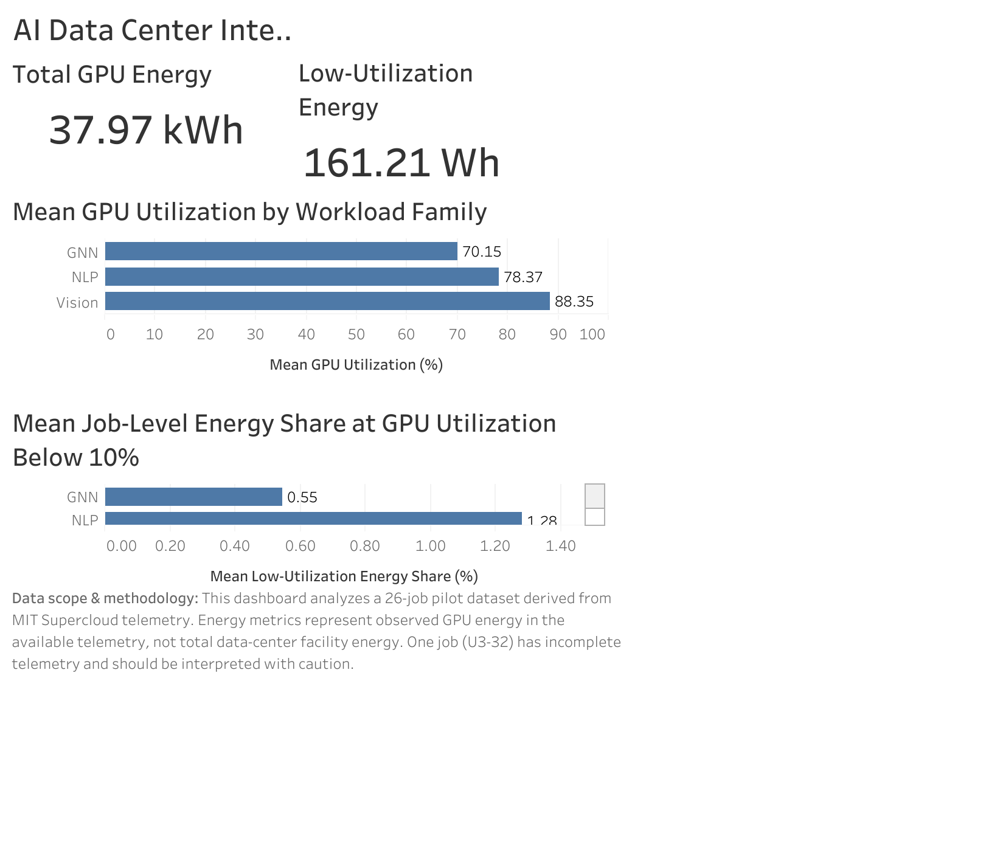

# AI Data Center Intelligence & Optimization Platform

An analytics platform for investigating GPU utilization, power consumption, telemetry quality, and potential operational inefficiencies in AI data center workloads.

## 🔎 Live Dashboard

**[Explore the AI Data Center Intelligence Dashboard on Tableau Public](https://public.tableau.com/views/AIDataCenterIntelligence-Recovery/Dashboard1?:language=en-GB&:sid=&:redirect=auth&:display_count=n&:origin=viz_share_link)**

Explore GPU telemetry, workload behavior, anomaly screening, and operational investigation findings through the interactive dashboard.

[](https://public.tableau.com/views/AIDataCenterIntelligence-Recovery/Dashboard1?:language=en-GB&:sid=&:redirect=auth&:display_count=n&:origin=viz_share_link)


## Project Overview

This project uses real-world MIT SuperCloud GPU telemetry to build a data-driven investigation workflow. It combines telemetry profiling, job-level analytics, anomaly screening, energy analysis, and an operational review queue to help identify workloads that warrant further investigation.

The current implementation focuses on **evidence-based investigation**, not automated production optimization.

## Current Capabilities

- **Telemetry ingestion and transformation:** Python modules for working with GPU telemetry data.
- **Job-level analytics:** Consolidated investigation views and workload-level performance indicators.
- **Anomaly screening:** Exploratory comparison of IQR-based screening and Isolation Forest.
- **Energy and power analysis:** Estimated energy during selected low-utilization episodes and comparisons of power across workload phases.
- **Operational prioritization:** Investigation tiers with a data-quality override for incomplete telemetry or GPU allocation mismatches.
- **Visualization:** Tableau Public dashboard and generated workload-transition case studies.
- **Artifact validation:** Automated checks for required files, duplicate job IDs, investigation-tier counts, data-quality overrides, and energy-to-power observation reconciliation.

## Selected Findings

The current investigation view contains 26 jobs:

| Investigation classification | Jobs |
|---|---:|
| Tier 1 — High investigation | 3 |
| Tier 2 — Investigate | 7 |
| Tier 3 — Monitor | 15 |
| Data-quality review | 1 |

The analysis identified three jobs for high-priority investigation. Across selected sustained low-utilization episodes in those jobs, estimated energy consumption totals approximately **29.83 Wh**.

This is energy observed during the selected episodes, **not demonstrated recoverable energy or verified savings**. Power differences between workload phases are descriptive and do not establish causality.

Anomaly screening is exploratory because the dataset does not contain ground-truth anomaly labels. The screening results should not be interpreted as a validated predictive model.

## Technology Stack

- Python
- Pandas and NumPy
- scikit-learn
- Jupyter Notebook
- Tableau Public
- Pytest

## Repository Structure

```text
ai-data-center-intelligence/
├── data/
│   ├── raw/          # Local source data; excluded from Git
│   ├── processed/    # Derived analytical datasets
│   └── reference/    # Data manifests, quality reports, and audits
├── docs/             # Project and data-source documentation
├── notebooks/        # Exploratory analysis
├── outputs/          # Case studies, audits, and visualizations
├── src/
│   ├── analytics/
│   ├── ingestion/
│   └── transformation/
├── tests/            # Automated validation tests
├── .gitignore
├── requirements.txt
└── README.md
```

## Setup

Use Python 3.12 or a compatible Python version supported by the listed dependencies.

```bash
python -m venv .venv
source .venv/bin/activate
python -m pip install -r requirements.txt
```

Run the artifact validation tests:

```bash
python -m pytest tests/test_validate_artifacts.py -v
```

The current validation suite contains three tests covering baseline artifact validation, duplicate job IDs, and the required data-quality override.

## Limitations

- Findings are based on the available telemetry and selected workloads; they are not necessarily representative of all AI data center operations.
- Sustained low utilization is an investigation signal, not proof of waste.
- Energy estimates use a one-second-per-sample assumption for the selected telemetry.
- Proposed investigation thresholds are operational heuristics, not validated production policies.
- No causal optimization experiment has established achievable energy savings.
- The RAG assistant and agentic root-cause analysis are future development goals, not completed capabilities.

## Roadmap

1. Strengthen reproducibility and data-quality validation.
2. Complete and document the core analytical workflow.
3. Refine dashboard usability and operational review workflows.
4. Validate anomaly detection against reviewed cases.
5. Design controlled optimization experiments.
6. Develop a retrieval-augmented assistant and evidence-grounded root-cause analysis workflow.

## Data Provenance

See [`docs/data_sources.md`](docs/data_sources.md) for source attribution, data handling, and analytical limitations.